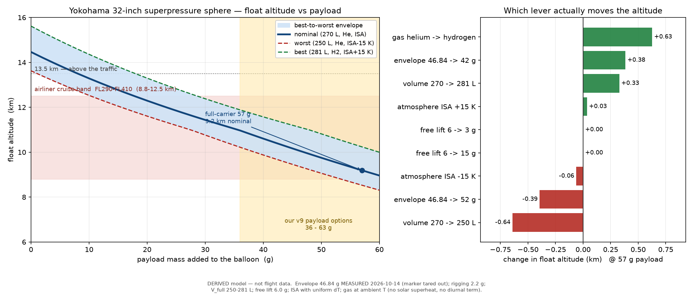

# Balloon volume and float altitude — the Yokohama 32″ sphere

**Date:** 2026-10-14 · **Status:** volume pinned by three independent derivations;
float-altitude curves committed · **Supersedes** the volume range quoted loosely in
`ALTITUDE-AND-MASS-REQUIREMENTS.md`.

This closes the last unknown in the mass chain. The envelope **mass** is measured
(**46.84 g**, marker tared out — `MEASURED-MASSES.md`); this document pins its
**volume**, which together fix the float altitude as a function of payload.

---

## 1. The volume — three derivations, one answer within 11 %

The operator located the manufacturer's own volume statement for this exact product
(`Crystal Clear Sphere Balloon (32inch)：1bag(10pieces)`, `（240806）No Valve`):

| Derivation | Volume | Basis |
|---|---|---|
| **Geometric sphere at the nominal 32″ diameter** | **281.2 L** | `V = 4/3 π (32·0.0254/2)³` |
| **At the community's 100″ stretched circumference** | **276.7 L** | D = 100 in/π = 80.85 cm |
| At 105″ circumference (max stretch before burst) | 320.3 L | not a design point — shown for scale |
| Manufacturer statement | **270 L** | product page, "270 litres" |
| Community statement | 240–270 L | "around 0.25 m³ with stretching" |

**Reading:** the independent derivations land **within ~11 %** of each other
(270–281 L). That agreement is the reason the curves below can be given as a band
rather than a single line: **volume is the dominant lever** (§4), and this is how
much it legitimately moves.

The volume does **not** need a new measurement. The remaining uncertainty is not in
the geometry — it is in *how far this particular film stretches before it goes
taut*, and that is bounded above by the 100–105″ community practice.

### Volume as a range, not a point

| Case | Volume | Justification |
|---|---|---|
| worst | **250 L** | conservative — below the community's lower bound, for margin |
| nominal | **270 L** | the manufacturer's own figure |
| best | **281 L** | geometric full inflation at nominal diameter |

---

## 2. Gross buoyancy at 15 °C, 1013.25 hPa

Air at ISA sea level is **1.2250 g/L**. With `ρ_gas = ρ_air · M_gas/M_air`
(M_air = 28.9647, M_He = 4.0026, M_H₂ = 2.01588):

| Gas | ρ_gas | net lift | over 276.7 L |
|---|---|---|---|
| helium | 0.1693 g/L | **1.0557 g/L** | **292.1 g** |
| hydrogen | 0.0853 g/L | **1.1397 g/L** | **315.4 g** |

So the gross lift is ~292 g (He) against a **46.84 g** envelope plus **2.2 g**
rigging — there is plenty of raw lift. What limits the altitude is not buoyancy in
absolute terms but the **density of the air at altitude**: the balloon can only float
where `ρ_air` is dense enough to carry the all-up mass.

---

## 3. The float condition, and what it does *not* depend on

A superpressure balloon carries a **fixed mass** of gas. It launches **partly
filled**, the film expands as it rises, and once taut the volume is constant. At
float the gas has equilibrated to ambient conditions, so:

```
ρ_air(alt_float) = M_dry / ( V_full · (1 − M_gas/M_air) )
```

where `M_dry` = payload + envelope + rigging.

Two consequences that decide how to read the curves:

- **The float altitude depends only on `M_dry` and `V_full`** — *not* on how much
  gas was put in. Free lift sets the launch fill, and therefore only *whether* the
  envelope reaches full volume. The model verifies this: changing free lift from
  3 g to 15 g moves the float altitude by **less than a metre**.
- **The nominal case launches ~33 % full.** That is correct and safe — filling to
  taut on the ground is not how these are flown. The script prints the fill
  fraction per case so this is visible rather than assumed.

### Model validation against real flights

Three logged flights on this envelope (community number bank):

| Payload | Model | Community | Δ |
|---|---|---|---|
| 7 g | 13.77 km | 13.5 km | +0.27 km |
| 28 g | 11.76 km | 10.3 km | +1.46 km |
| 40 g | 10.80 km | 10.0 km | +0.80 km |

**Within ~1.5 km on three independent flights.** The model is not optimistic by a
factor, so the curves can be read directly. The residual is expected: the community
figures are rounded, and those flights were not at ISA.

---

## 4. Float altitude vs payload



| Payload | Total mass | worst | **nominal** | best |
|---|---|---|---|---|
| 0 g | 49.0 g | 13.63 km | **14.46 km** | 15.62 km |
| 10 g | 59.0 g | 12.53 km | **13.29 km** | 14.36 km |
| 20 g | 69.0 g | 11.61 km | **12.29 km** | 13.30 km |
| 30 g | 79.0 g | 10.76 km | **11.44 km** | 12.38 km |
| 40 g | 89.0 g | 9.88 km | **10.60 km** | 11.57 km |
| 50 g | 99.0 g | 9.06 km | **9.75 km** | 10.82 km |
| 60 g | 109.0 g | 8.31 km | **8.96 km** | 10.00 km |

### What our payload options do

| Array option | Payload | worst | **nominal** | best |
|---|---|---|---|---|
| cells-only | 36 g | 10.22 km | **10.97 km** | 11.88 km |
| spine + ribs | 41 g | 9.79 km | **10.52 km** | 11.50 km |
| **full carrier (as built)** | **57 g** | **8.53 km** | **9.19 km** | **10.24 km** |
| double-sided carrier | 63 g | 8.09 km | **8.73 km** | 9.76 km |

### Maximum payload for a target altitude (nominal case)

| Target | All-up mass needed | Payload available | |
|---|---|---|---|
| 10 km | 96.0 g | **+47.0 g** | reachable |
| 11 km | 84.7 g | **+35.6 g** | reachable |
| 12 km | 72.3 g | **+23.3 g** | reachable |
| 13 km | 61.8 g | **+12.7 g** | reachable |
| 14 km | 52.8 g | **+3.7 g** | reachable |
| 15 km | 45.1 g | **−4.0 g** | **IMPOSSIBLE** |

**This is the direct answer to "how does altitude depend on payload weight".**
Roughly **0.1 km per gram** in the region of interest — the curve is close to
linear between 8 and 14 km, so a gram costs about a hundred metres.

---

## 5. Which lever actually moves the altitude

At our 57 g payload (nominal 9.19 km):

| Change | Δ altitude |
|---|---|
| volume 270 → 250 L | **−0.64 km** |
| gas helium → hydrogen | **+0.63 km** |
| envelope 46.84 → 52 g | −0.39 km |
| envelope 46.84 → 42 g | +0.38 km |
| volume 270 → 281 L | +0.33 km |
| atmosphere ISA −15 K | −0.06 km |
| atmosphere ISA +15 K | +0.03 km |
| free lift 6 → 15 g | +0.00 km |
| free lift 6 → 3 g | +0.00 km |

**The weather term is small, and that is a result, not an omission.** Float is a
*density* condition; a uniform temperature offset barely shifts the density profile
at a fixed pressure. Temperature matters for the **diurnal excursion** (a few
hundred metres, not modelled here) and for **where the balloon drifts**, not for its
mean float level. The levers that matter are **volume** and **gas species**, both of
which are engineering choices.

---

## 6. What this means for the flight

1. **The 32″ sphere cannot clear airliner traffic.** The cruise band is
   8.8–12.5 km. Even at *zero* payload the nominal float is 14.5 km, but our
   payload puts it at **8.5–10.2 km** — squarely **inside** the band. To clear it
   needs ≥13.5 km, which allows only **+12.7 g** of payload.
2. **The array choice is worth ~1.8 km.** Going from the full carrier (57 g) to the
   cells-only array (36 g) buys 9.19 → 10.97 km nominal. That is the single largest
   *design* lever available after the envelope itself.
3. **Hydrogen is worth +0.63 km** — comparable to the volume uncertainty, and larger
   than the envelope mass lever. It is a real option, with real handling risk.
4. **Weather does not decide the altitude.** It decides how much the balloon
   oscillates around it and where it goes. Plan the float level from the payload
   and the volume; plan the flight *window* from the weather.

---

## 7. Corrections to a pasted AI answer

The volume figures arrived inside a pasted AI response. Its arithmetic was checked
and is **correct where it is checkable**: 275–281 L, He 1.05 g/L, H₂ 1.14 g/L,
~290 g and ~314 g gross lift. Three of its other claims needed handling:

| AI claim | Verdict |
|---|---|
| envelope "oft um die 40–45 g" | **superseded** — our own unit is measured at **46.84 g**; the AI figure is low |
| "free lift 10 to 15 g" | **NOT adopted.** The repo's sourced band is **5–8 g** (Traquito 5–7, NIBBB 6–7, desertrats 6–8, Ruthroff "five or six"), and the protocol rejects >8 g as a burst risk. The AI's band is 2× the sourced upper bound |
| "yellow, tough plastic / TPU blend" | **corrected** — the manufacturer states **"Nylon, Polyethylene"**, i.e. a nylon/PE laminate, not TPU |
| "no valve, heat-seal the fill tube" | correct and consistent with the product variant `No Valve` |

Note the free-lift disagreement does **not** affect the altitude curves: free lift is
a rounding term for float altitude (§3), which is why adopting the wrong band would
have been harmless here — but it is still recorded rather than silently inherited.

---

## 8. Reproduce

```bash
python3 docs/analysis/balloon_altitude_vs_payload.py
```

Writes `docs/analysis/out/balloon_altitude_vs_payload.csv` (every case, with fill
fraction and gas mass) and the figure above. Tests:
`tests/test_balloon_altitude_vs_payload.py`.
