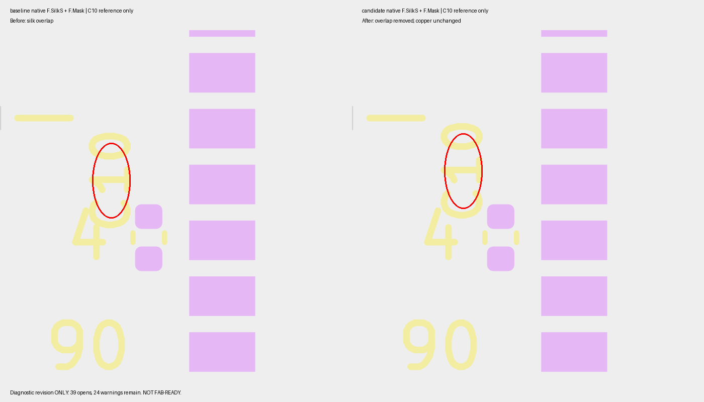
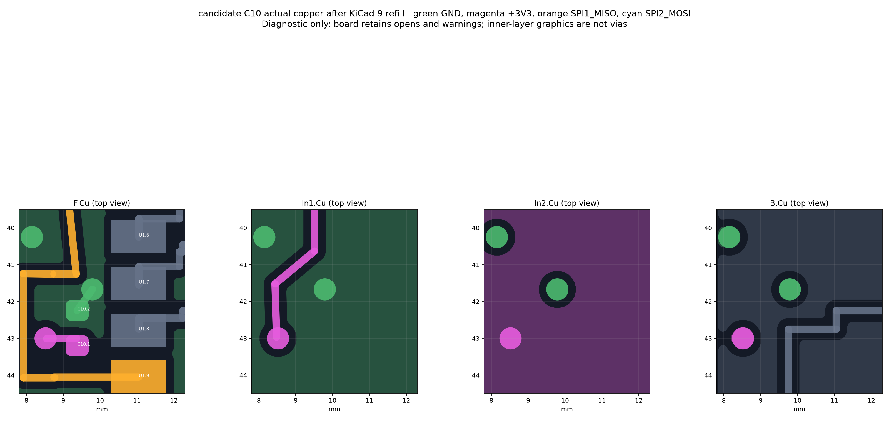

# C10 silk-only acceptance milestone — NOT FAB READY

Recovered and verified the exact newer c10-ground-native-trial, not failed PR468 head 853f648c. Original candidate remains untouched and quarantined.

## Result
Only C10 Reference moved north 0.22 mm (world y 41.42 -> 41.20). Entire resulting board differs by exactly one reference-coordinate line. Component placement, copper, filled zones and paired rules are byte-identical to the refilled input. Original source trial candidate and refilled baseline SHA256: `06c951867d7a0be1d80578610c2e55397428b7379da409b08d98c115946b7944`.
Repaired candidate SHA256: `b899ad04f1e61bd4693b52f9a5275b4a406d8dfc59b778138d598ce768b90fbd`.
PRO SHA256: `01063b32bcba962ba2ee89fa5acbd55a96b006d78567a3037403b05965a75b02`.
DRU SHA256: `b8b321bb182b0f63515a80186e3f92127ac1dbe3aa4ddf9b797168a2af9b39a7`.

## Actual execution
- `/usr/bin/python3 repair.py`: exit 0; native ZONE_FILLER both copies, saved.
- `kicad-cli pcb drc --format json --severity-all --exit-code-violations -o <label>/drc.json <label>/board.kicad_pcb`: exit 5 both. 25 -> 24 warnings, 39 -> 39 opens. Only removed warning identity is C10 reference vs J_W1 text 4 silk_overlap; zero new violation identities.
- `geometry.py` using KiCad-enabled audit venv: exit 0, freshly rebuilds native-shape/per-filled-polygon graph and layer renders for both copies.
- `/usr/bin/python3 verify.py`: exit 0. 1,834 retained nonpolygon layer nodes, zero missing or lost connections; complete node and edge sets identical, including all SPI1_MISO and SPI2_MOSI attachments. C10.1 reaches U1.2; C10.2 reaches U7.2. 1,834 includes five layer nodes added by the original GND stub/through-via; its predecessor baseline had 1,829. This does not contradict the original result.
- DRC ratsnest anchor multiset changed by 8 removed/8 added despite identical copper/graph; explicitly retained in verification.json, not misreported as new opens.
- `check_silk.py --board candidate/board.kicad_pcb --json candidate/silk.json`: exit 1. Three inherited silk_over_copper findings remain on U_LORA1280 (two segments, one reference). No waiver or unrelated silk edit.
- Native SVG exports and rsvg-convert: exit 0; annotated image inspected by vision, supporting improved C10/4 separation only.

## Images

## Reviewer findings still open
Prior actual served gpt-6-astra review was CHANGES_REQUESTED; full text in prior-astra-review.md. This revision resolves only its explicit new silk regression. The unchanged 0.208206115 mm measured minimum copper clearance leaves 8.206 um over the 0.20 rule; it is NOT robust manufacturing-margin qualification. Copper-neck width, return/decoupling quality, fab mask/process and assembly qualification remain unaccepted. No new Astra acceptance verdict obtained. Source parity/ERC and complete production custom gates remain owed. 39 remaining opens have not been individually adjudicated; none are blanket-waived as assembly.

## Next gate
Manufacturing-margin/return-path review and production parity/custom gates, plus inherited U_LORA1280 silk and explicit open-by-open disposition, precede adoption. Copper/component movement would exceed this revision's scope. No manual operator action currently identified; no order/signoff request appropriate. This is a draft evidence candidate, not a canonical board replacement. No merge or order performed.

## Reproduction
Keep same-stem rules beside each board. Run native DRC as above, `geometry.py` in an environment with pcbnew/shapely/matplotlib, then `verify.py`. repair.py deliberately refuses a second modification (original reference position asserted). Original evidence lives at ~/reports/flight-readiness-20261102/c10-ground-native-trial. No edits there or in dirty source worktrees.
