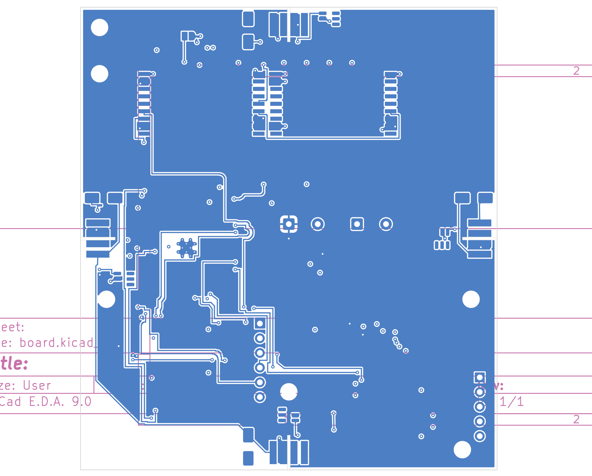

# O35 ground repair candidate — NOT ORDERABLE

## Outcome
One new 0.20 mm B.Cu segment joins D_BP4.2 at (29,6) to the **existing** 0.60/0.30 mm through-via at (31.040292,6). No new via, via-in-pad, component movement, C10 movement, rule relaxation or canonical replacement. Candidate SHA256 `fe11ee72c1206fb0715a9cee701961b8a1de37c0c7aaef663172bcf7bf9264c9`.

Input is exact PR470 board `b899ad04f1e61bd4693b52f9a5275b4a406d8dfc59b778138d598ce768b90fbd`, at PR471 commit `d3d61f64ff4ee2420938dcf23ff915d3b5620151`. All original footprints, tracks, vias and board graphics are byte-identical between native-refilled baseline and candidate; `object-preservation.json` records the sole added segment. Full paired project/rule files are unchanged.

## Source intent and provenance
The checked-in `tracker/hardware/schematics/flight_board/v10_flight.kicad_sch` and `connectivity/v10_pinmap.reg` were last changed by `4ae2594b` (ADR-139/137 schematic reconciliation). This is newer evidence than the November 2 mismatch report. Hashes and per-pin bindings are in `source-probe.json`.

Fresh schematic export, current registry, and pinned board agree: **53 nets and complete per-net pad sets** (`check_schematic_parity.py`, explicit board/schematic/`--registry`, exit 0). Direct registry/export set equality also passes. D_BP4.1 is /W3_SOLAR_N; D_BP4.2, J_W4.4, U7.2 and C10.2 are GND in all these sources. Registry lines 284–286 explicitly identify diode anode as stack-bottom ground, citing ADR-129 D2 / ADR-051 §2.7. Therefore O35 intent is not inferred from a board label alone.

**The committed `v10_flight.net` is stale** and is not the adopted netlist source. It still names U_E28 instead of U_LORA1280 and differs in numerous radio, programming and power nodes; complete delta in `measurement.json`. D_BP4.1/.2 themselves agree even in that old netlist. No source/netlist/registry files were overwritten or regenerated in place. Fresh `v10-export.net` accompanies this repair as evidence, not a source replacement.

Parity is not ERC acceptance: native all-severity ERC exits **5**, with **9 errors** (5 label_dangling, 2 power_pin_not_driven, 2 pin_not_driven) and **21 warnings** (16 lib_symbol_issues, 5 footprint_link_issues). The parity script reports G2 PASS only because those 9 errors fit its existing allowance. Annotation warning also emitted during export. Full candidate source/production acceptance remains open; do not call this zero-error ERC or fabrication readiness.

## Geometry and execution
The actual rotated D_BP4.2 copper bounds are x 28.1–29.9, y 4.75–7.25 mm. Existing through-via copper is **0.840292 mm outside the pad edge**. New stub length is 2.040292 mm; no drill change. A deterministic direct connection to that already-connected same-net via was tested—no exhaustive routing search and no unmeasured new via coordinate. `measurement.json` records dimensions; native DRC on the assembled/refilled geometry is the legality test.

- `/usr/bin/python3 repair.py`: exit 0; native ZONE_FILLER on isolated baseline/candidate.
- `kicad-cli pcb drc --format json --severity-all --exit-code-violations -o <label>/drc.json <label>/board.kicad_pcb`: both exit 5; **39 → 38 opens**, **24 → 24 violations**, identical unordered violation identities (type/severity/item UUIDs), zero new identities.
- `/usr/bin/python3 geometry.py`: exit 0; fresh native-shape/per-filled-polygon graph for both objects.
- `/usr/bin/python3 verify.py`: exit 0; **1,834 retained nonpolygon layer nodes**, zero previously connected retained-node pairs broken. Exact D_BP4.2 UUID `0b5d101b-cf4c-4c94-a581-5020ff4b1a7d` now reaches F.Cu track `3785d7c4-b54b-4758-b0dc-3979b462f16c`. C10.1→U1.2 and C10.2→U7.2 preserved; all retained SPI connections included in the all-pairs preservation test. Polygon identity itself is not asserted across refill; graph includes fresh filled polygons.
- All original footprints/tracks/vias/graphics preserved byte-for-byte; only one segment added. This includes C10 and SPI geometry. Native SVG export and rsvg-convert exit 0; image inspected as a rendered bottom copper view, not electrical proof.

## Actual candidate image
B.Cu + Edge.Cuts, top-view orientation, native KiCad export (drawing-sheet graphics remain visible). Source hash is the candidate hash above. Image is diagnostic only, not a fabrication or assembly approval.

## Still open
38 native opens, inherited 24 DRC warnings and strict U_LORA1280 silkscreen failures; source ERC errors and stale committed netlist reconciliation; production custom suite; C10 Astra CHANGES_REQUESTED, 8.206 µm nominal clearance headroom and neck/return-path concerns; stackup/process/assembly qualification. No fresh reviewer approval. No canonical merge or order. ngit signer unavailable; no mirroring claimed.

Related: PR470 silk-only candidate and PR471 inventory. Publication should be a repair milestone stacked on PR471, not another broad docs-only readiness PR.
