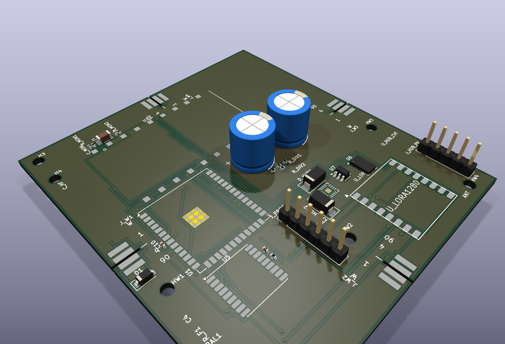
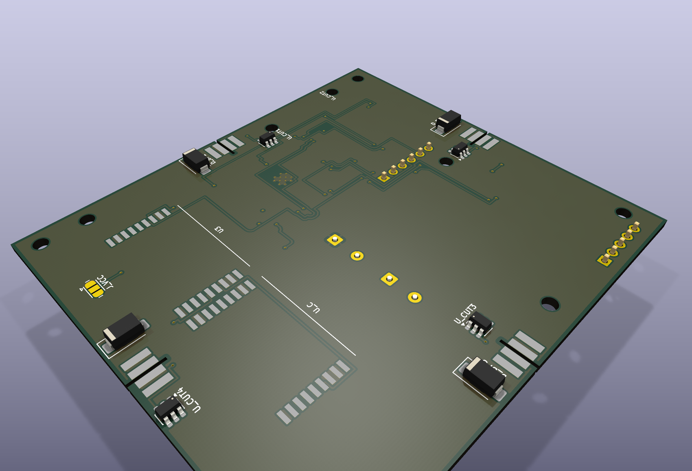

# Balloon hub board v10 — JLCPCB order

**Ordered from JLCPCB: 10 assembled boards, double-sided PCBA.**

This page shows the board as it will arrive. The renders are generated from the exact PCB file that
produced the shipped fabrication and assembly data — not from a concept drawing.

---

## 3D render — top side

19 components are fitted by JLCPCB on this side. The two tall blue parts are the bulk storage
capacitors; the black headers are the programming and power-monitor connections.

---

## 3D render — bottom side

4 components are fitted here — the `D_BP1`–`D_BP4` bypass diodes.

**This is why the order is double-sided assembly** rather than the cheaper single-sided option: a
single-sided order would have shipped with four diodes missing. That mistake was caught on
2026-11-09, before the order went out.

---

## Board facts

| | |
|---|---|
| Outline | **72.1 × 80.1 mm** |
| Footprints on the board | 49 |
| Components fitted by JLCPCB | **23** |
| Assembly split | **19 top / 4 bottom** |

---

## What JLCPCB assembles

| Block | Parts | Side |
|---|---|---|
| Main module (ESP32-S3) | `U1` | top |
| Bypass diodes | `D_BP1`–`D_BP4` | **bottom** |
| Blocking / hub diodes | `D1`, `D_HUB1`, `D_HUB2` | top |
| Bulk + decoupling | `C10`, `C4`, `C_BULK`, `C_HF`, `C_MON` | top |
| Monitor divider | `R_MON1`, `R_MON2`, `R_BAL1`, `R_BAL2`, `R_DIV1`, `R_DIV2` | top |
| Regulator / limiter | `U7`, `R_F1` | top |
| Connectors | `J_HUB_PV`, `J_PROG` | top |

---

## Reading the renders honestly

This is a **CAD render of the board file, not a photograph**.

Every one of the 23 fitted parts has a 3D model, so what you see fitted is what will arrive.

The large bare pad areas — the LoRa module site and the wing connector positions — are **not
populated in this order**. They ship as solder pads for parts fitted later by hand. That is
deliberate, not an omission.

---

### Source

- Renders: KiCad 9.0.9, `kicad-cli pcb render --quality high --floor --perspective`
- Board file: `tracker/hardware/hub_board_v10_lora1280_7of9.kicad_pcb`
- Assembly data: `docs/fab/v10-order-double-sided/cpl-jlc.csv` (23 placement rows)
- Board outline measured on the board file: 72.1 × 80.1 mm
